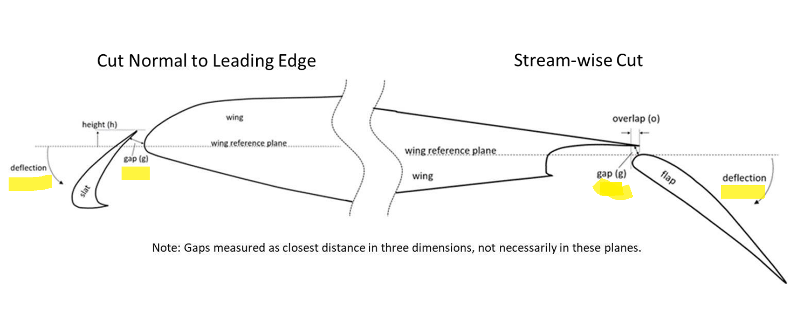
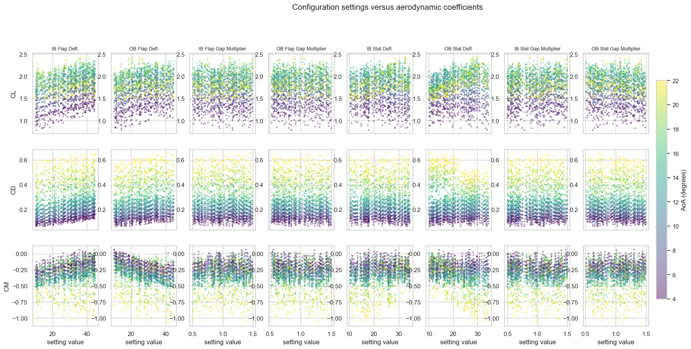
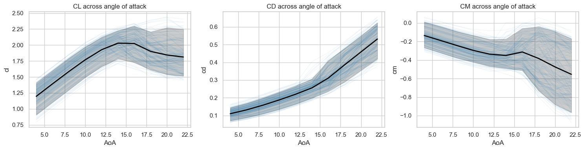
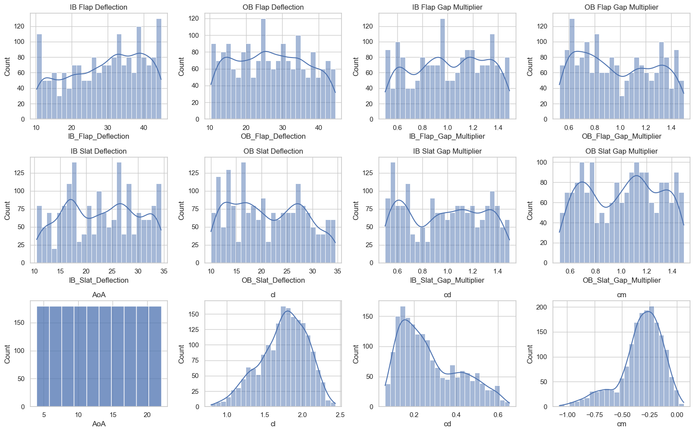
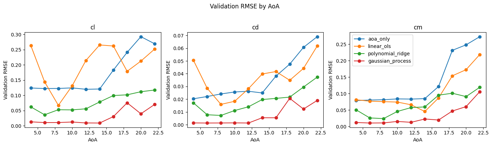
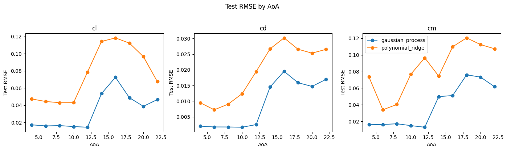
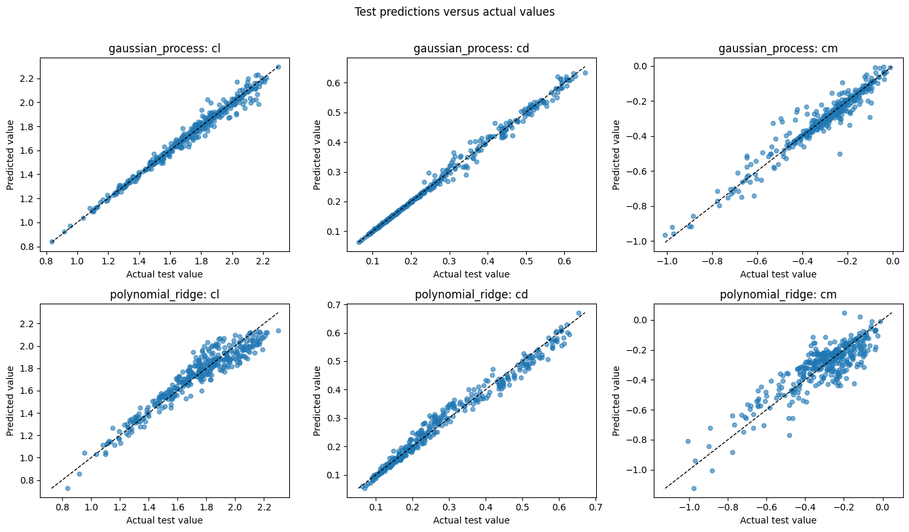
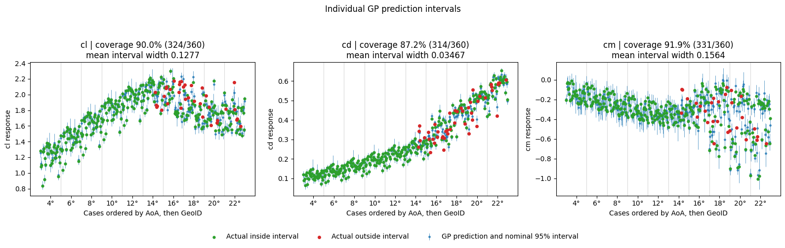

# Surrogate model for aerodynamic coefficients from geometry and AoA

1. Dataset

   1. I used HiLiftAeroML, a public CFD dataset with different high-lift geometries and angles of attack (AoA). The simulations provide lift (`cl`), drag (`cd`), and pitching-moment (`cm`) coefficients.
   2. The aim is to predict these coefficients for unseen geometries. This surrogate uses only the geometry inputs and AoA, not the surface or flow-field outputs from the simulations.
   3. Available data:

      1. There are 180 geometries, each with ten AoA cases from 4° to 22° in steps of 2°: 1,800 cases in total.
      2. The eight geometry inputs describe the deflections and gap multipliers of the inboard and outboard slats and flaps. Inboard is nearer the aircraft body; outboard is farther away.
      3. The image below illustrates the slat and flap geometry. Gap and deflection are highlighted in yellow. Height and overlap are also shown in the diagram, but they are not inputs to these models since they depend on other deflection and gap.

         
      4. AoA is the ninth input. The three targets are `cl`, `cd`, and `cm`.
   4. Data visualization:

      

      Figure 1 shows the relationships between the eight geometry inputs and the three targets. The eight columns represent geometry inputs, the three rows represent targets, and colour represents AoA.

      

      Figure 2 shows how the aerodynamic coefficients change with AoA.

      

      Figure 3 shows the marginal distribution of each input feature.
2. Split

   1. Since the aim is to predict coefficients for unseen geometries, each geometry appears in only one of the training, validation, or test sets. All ten AoA cases for a geometry stay together.
   2. I used the official geometry split provided with the dataset. I did not generate a new split.
      1. Training: 126 geometries and 1,260 cases.
      2. Validation: 18 geometries and 180 cases.
      3. Test: 36 geometries and 360 cases.
   3. This evaluates performance on unseen geometries within this dataset. It does not establish performance outside the sampled geometry ranges or at new AoAs.
3. Preprocessing

   1. I used standardization for polynomial Ridge and GP because feature scales affect the regularization penalty and kernel distances. The AoA-only baseline used unscaled inputs.
   2. Standardization uses the following formula:

      $$
      z = \frac{x-\mu_{\text{train}}}{s_{\text{train}}}
      $$

      Here, the mean and standard deviation are learned only from the training data. During cross-validation, they are learned separately from each fold's training portion.
   3. For polynomial Ridge, the polynomial features are created first and then standardized. For GP, the nine original inputs are standardized.
4. Models and results

   1. AoA-only baseline:
      1. I started with a baseline that predicts the training mean of each target at a given AoA. This shows how much can be predicted without geometry information.
      2. It is a mean lookup, not a fitted straight-line regression. It gives the same prediction to every geometry at a particular AoA.
   2. Ordinary least squares (OLS):
      1. I then used all nine inputs to check how well an additive linear model could explain the targets.
      2. OLS improved `cm`, but its validation `cl` error was worse than the AoA-only baseline. The remaining errors showed an AoA-dependent pattern.
   3. Polynomial Ridge regression:
      1. The plots suggested nonlinear behaviour, so I added degree-two terms and interactions.
      2. The expansion contains:
         1. Nine original inputs.
         2. Nine squared terms.
         3. 9 × 8 / 2 = 36 pairwise interactions.
         4. This gives 54 features, plus an intercept.
      3. Ridge penalizes large coefficients, helping control sensitivity when polynomial terms are correlated.
      4. I selected alpha using five-fold cross-validation grouped by geometry, using training data only. The selected values were 0.1 for `cl` and 1 for `cd` and `cm`.
   4. Gaussian process (GP):
      1. I tried GP to model nonlinear relationships and obtain model-based uncertainty estimates.
      2. I compared RBF, Matérn 1.5, and Matérn 2.5 kernels using five-fold cross-validation grouped by geometry. Each kernel used a separate length scale for each input (ARD).
      3. The kernel parameters were optimized by maximizing log marginal likelihood on the training portion of each fold. CV compared the kernel families using held-out RMSE.
      4. Matérn 1.5 was selected for all three targets. The selected models were then fitted on the full training set.
   5. Validation and model choice:
      1. I compared the models using:

         1. MAE: the average absolute prediction error.
         2. RMSE:
         3. R²: compares the predictions with a constant prediction equal to the mean of the evaluated target values.
      2. The overall validation results are shown below. Values are rounded for readability.

         | Target | Model            | MAE      | RMSE     | R²      |
         | ------ | ---------------- | -------- | -------- | -------- |
         | `cl` | AoA-only         | 0.142320 | 0.184291 | 0.696275 |
         | `cl` | OLS              | 0.178400 | 0.209156 | 0.608787 |
         | `cl` | Polynomial Ridge | 0.063269 | 0.081532 | 0.940554 |
         | `cl` | GP               | 0.020616 | 0.037197 | 0.987627 |
         | `cd` | AoA-only         | 0.029068 | 0.039513 | 0.908863 |
         | `cd` | OLS              | 0.031666 | 0.038803 | 0.912110 |
         | `cd` | Polynomial Ridge | 0.015438 | 0.020679 | 0.975039 |
         | `cd` | GP               | 0.004977 | 0.010041 | 0.994114 |
         | `cm` | AoA-only         | 0.117285 | 0.156525 | 0.451207 |
         | `cm` | OLS              | 0.086190 | 0.118004 | 0.688085 |
         | `cm` | Polynomial Ridge | 0.053314 | 0.073929 | 0.877576 |
         | `cm` | GP               | 0.024907 | 0.043410 | 0.957790 |
      3. GP had the lowest validation MAE and RMSE and the highest R² for all three targets. I selected GP before the final test evaluation and retained polynomial Ridge as a comparison model.

         
      4. GP uncertainty was less reliable than its point predictions. Fewer than 95% of actual validation values fell inside the nominal 95% intervals, and interval widths changed little with AoA.
   6. Test evaluation:
      1. I loaded the saved GP and polynomial Ridge models to evaluate the test set. No model was refitted or retuned in the final test notebook.

         | Target | Model            | MAE      | RMSE     | R²      |
         | ------ | ---------------- | -------- | -------- | -------- |
         | `cl` | GP               | 0.026258 | 0.039284 | 0.979880 |
         | `cl` | Polynomial Ridge | 0.065016 | 0.082222 | 0.911859 |
         | `cd` | GP               | 0.006645 | 0.011692 | 0.994260 |
         | `cd` | Polynomial Ridge | 0.015871 | 0.021050 | 0.981397 |
         | `cm` | GP               | 0.028066 | 0.046129 | 0.929528 |
         | `cm` | Polynomial Ridge | 0.069522 | 0.089287 | 0.735973 |

         

         

         
      2. GP retained its advantage over polynomial Ridge on test, although its RMSE was somewhat higher than on validation. Larger errors remained at higher AoAs.
      3. GP test interval coverage was 90.0% for `cl`, 87.2% for `cd`, and 91.9% for `cm`, below the nominal 95%. Coverage was particularly weak at higher AoAs
      4. The earlier learning experiments had already evaluated these test geometries. This rebuilt workflow reproduces the work; it is not a completely fresh blind test. The current test results were not used to change the selected model or its parameters.
5. If I had more time,

   1. I would explore physically motivated combinations of GP kernels using addition or multiplication. I would compare them using geometry-grouped CV rather than assume a more complex kernel will improve performance.
   2. I would compare a small MLP. since an MLP can represent nonlinear relationship. but in this case it may overfit with only 126 geometry
   3. I have not perfomed dedicated feature important analysis. I would investiage which importance changes with AOA.
6. Limitations:

   1. This dataset varies a particular high lift configuration. For completely different wing this model wont work.
   2. Prediciton outside 4 to 22 degree AoA is not validated.
   3. The nominal 95% intervals cover fewer than 95% of test values. I would not use them alone to accept an engineering design.
7. How would I implement in company.

   1. If the company has a small number of distinct wing or aircraft families, I would initially maintain a separately validated surrogate for each family.  Engineer would select the aircraft configuration and enter its geometry parameters and angle of attack. The tool would load the appropriate saved model and preprocessing, then return predicted cl, cd, and cm, with uncertainty estimates. Engineers could use it for quick comparision and initial screening.
   2. I could add design optimization. for example, at AoA = 20 deg, what geometry could be lowest prediced drag while meeting lift requirement. Optimizer varies allowed geometry and filter according to requirement and return the result.
8. How I used LLMs

   1. I initially used ChatGPT to understand the dataset paper and discuss modeling ideas.
   2. I used Codex primarily for coding for modifying a common notebook template for different models.
   3. I used separate ChatGPT conversations and Google searches to explore alternatives and understand the failure cases.

---

## How to run

Start with [06_final_test.ipynb](notebooks/06_final_test.ipynb), the final evaluation notebook. It loads the saved models and prepared test inputs and compares predictions with the test targets. It does not train or tune any model. The Gaussian process is the final selected model for `cl`, `cd` and `cm`; polynomial Ridge appears there only as a benchmark.

Use Python 3.10:

```bash
python -m pip install -r requirements.txt
```

- Notebook 01 prepares the data; notebooks 02-05 hold model development and validation.
- `data/` has the raw and prepared datasets; `results/models/` has the saved models; `results/` has prediction and metric CSVs.

