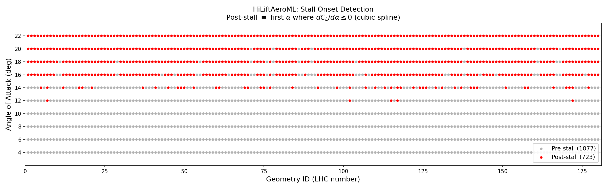

# HiLiftAeroML Dataset Splits

Deterministic train/val/test splits for the [HiLiftAeroML](https://huggingface.co/datasets/nvidia/HiLiftAeroML) dataset. Covers the **1800 complete LHC cases**: 180 geometries × 10 angles of attack (4-22 deg).

## Splits at a glance

| Split | Type | Train | Val | Test | What it tests |
|----------------|-------|----:|---:|----:|------------------------------|
| `full` | In-dist | 1260 | 180 | 360 | Baseline: random case-level split |
| `medium` | In-dist | 510 | 180 | 360 | Intermediate data efficiency between `full` and `scarce` |
| `scarce` | In-dist | 210 | 180 | 360 | Data efficiency (1/6 of `full` training data) |
| `super_scarce` | In-dist | 35 | 180 | 360 | Extreme data efficiency (1/36 of `full` training data) |
| `geometry` | In-dist | 1260 | 180 | 360 | Generalization to unseen geometries |
| `geometry_medium` | In-dist | 510 | 180 | 360 | Unseen-geometry generalization from 51 training geometries |
| `geometry_scarce` | In-dist | 210 | 180 | 360 | Unseen-geometry generalization from 21 training geometries |
| `geometry_super_scarce` | In-dist | 40 | 180 | 360 | Unseen-geometry generalization from 4 training geometries |
| `single_aoa_4` | In-dist | 126 | 18 | 36 | Geometry generalization at 4 deg (pre-stall) |
| `single_aoa_12` | In-dist | 126 | 18 | 36 | Geometry generalization at 12 deg (mid-range) |
| `single_aoa_22` | In-dist | 126 | 18 | 36 | Geometry generalization at 22 deg (post-stall) |
| `aoa` | OOD | 788 | 112 | 900 | AoA extrapolation: low AoA → high AoA |
| `deflection` | OOD | 1260 | 180 | 360 | Geometry extrapolation: low → high deflection |
| `stall` | OOD | 942 | 135 | 723 | Flow regime: pre-stall → post-stall |

**Difficulty and data-efficiency ladders:**

- Case-level data efficiency: `full` < `medium` < `scarce` < `super_scarce` (1260 / 510 / 210 / 35 training cases, same val/test)
- Geometry data efficiency: `geometry` < `geometry_medium` < `geometry_scarce` < `geometry_super_scarce` (126 / 51 / 21 / 4 training geometries, all 10 AoAs per geometry, same val/test)
- Geometry generalization: `full` < `geometry` < `deflection`

## Which split should I use?

- **Simple baseline** → `full`
- **Geometry generalization** (primary ML challenge) → `geometry`
- **Hardest OOD challenge** → `deflection` or `stall`
- **AoA extrapolation** → `aoa`
- **Case-level data efficiency study** → compare `super_scarce`, `scarce`, `medium`, and `full` (same val/test)
- **Geometry data efficiency study** → compare `geometry_super_scarce`, `geometry_scarce`, `geometry_medium`, and `geometry` (same held-out geometries)
- **Single-AoA evaluation** → `single_aoa_4`, `single_aoa_12`, `single_aoa_22`

## Design principles

- **Val is always in-distribution with train.** For OOD splits, the val set is drawn from the training-side population, never from the OOD test region. Hyperparameter tuning never sees out-of-distribution data.
- **Consistent ratios.** Splits with random/ranked geometry selection use 80/20 test fraction (70/10/20 overall). The `aoa` and `stall` splits have ratios dictated by their physics-based boundaries.
- **Shared held-out geometries.** The `geometry*` and `single_aoa_*` splits use the same 18 val and 36 test geometries, enabling direct comparison across training-set sizes and AoA regimes.
- **Test set integrity.** The test set should not be used to inform any training or hyperparameter decisions.

## Split details

### `full`

Random 70/10/20 partition of all 1800 cases. A given geometry may appear at different AoA values in train, val, and test. The model may have seen the same geometry at other angles of attack.

### `medium`, `scarce`, and `super_scarce`

Same val/test as `full`, but with nested random subsamples of `full_train`. `medium` contains 510 cases, near the geometric midpoint between `full` (1260) and `scarce` (210); `scarce` uses 1/6 of `full_train` (210 cases), and `super_scarce` uses 1/36 (35 cases). A single deterministic priority ordering defines every level, so `super_scarce_train` ⊂ `scarce_train` ⊂ `medium_train` ⊂ `full_train`. The added midpoint resolves the previously six-fold jump between `full` and `scarce` while leaving every published assignment unchanged.

### `geometry`

Splits the 180 geometries into 126 train, 18 val, and 36 test (all 10 AoA values per geometry). Unlike `full`, the model never sees a test geometry during training - not even at a different AoA - so it must generalize to entirely new shapes. Val and test geometries are randomly selected from the same LHC distribution as training.

### `geometry_medium`, `geometry_scarce`, and `geometry_super_scarce`

Nested data-efficiency variants of `geometry`. They retain the exact same 18 validation and 36 test geometries as `geometry`, but reduce the training population to 51, 21, and 4 complete geometries, respectively. Every selected training geometry retains all 10 AoAs, giving 510, 210, and 40 training cases. One deterministic geometry ordering defines the nested relationship `geometry_super_scarce_train` ⊂ `geometry_scarce_train` ⊂ `geometry_medium_train` ⊂ `geometry_train`. Keeping complete AoA trajectories isolates the effect of geometry coverage instead of confounding it with incomplete operating-condition coverage.

### `aoa`

Trains and validates on AoA ≤ 12 (pre-stall regime); tests on AoA ≥ 14. All 180 geometries appear in all three sets. The 12/14 deg cutoff is physics-motivated: around 14-16 deg, the dominant aerodynamic sensitivity shifts from flap deflection to slat deflection, and most geometries begin to stall. Val is a random 1/8 of the pre-stall pool.

### `deflection`

Sorts geometries by mean deflection angle (average of IB/OB flap and slat deflections). Trains and validates on the bottom 80% (low deflection); tests on the top 20% (most aggressive high-lift settings). Val is a random 1/8 of the low-deflection pool. This is a harder variant of `geometry` - both hold out entire geometries, but `deflection` selects adversarially from the extremes of the design space rather than randomly.

### `stall`

For each geometry, fits a cubic spline to CL(α) and identifies the first AoA where dCL/dα ≤ 0 (stall onset). Everything from that AoA onward is post-stall. Trains and validates on pre-stall cases; tests on all post-stall cases. Val is a random 1/8 of the pre-stall pool. All 180 geometries exhibit stall - the majority (100) at 16 deg, with a secondary cluster (44) at 14 deg.



### `single_aoa_4`, `single_aoa_12`, `single_aoa_22`

Per-AoA variants of `geometry`: same 126/18/36 geometry split, restricted to a single angle of attack. AoA 4 (pre-stall), 12 (mid-range), and 22 (post-stall) represent three distinct flow regimes.

## Regenerating

```bash
uv run splits/generate_splits.py
```

All 14 split families are deterministic (fixed seed). The script reads CL data from the dataset for the `stall` split and geometry parameters for the `deflection` split.

## Manifest format

```json
{
    "full_train": ["geo_LHC001_AoA_4", ...],
    "full_val": [...],
    "full_test": [...],
    ...
}
```

Case IDs match on-disk directory names, sorted by geometry number then AoA.
